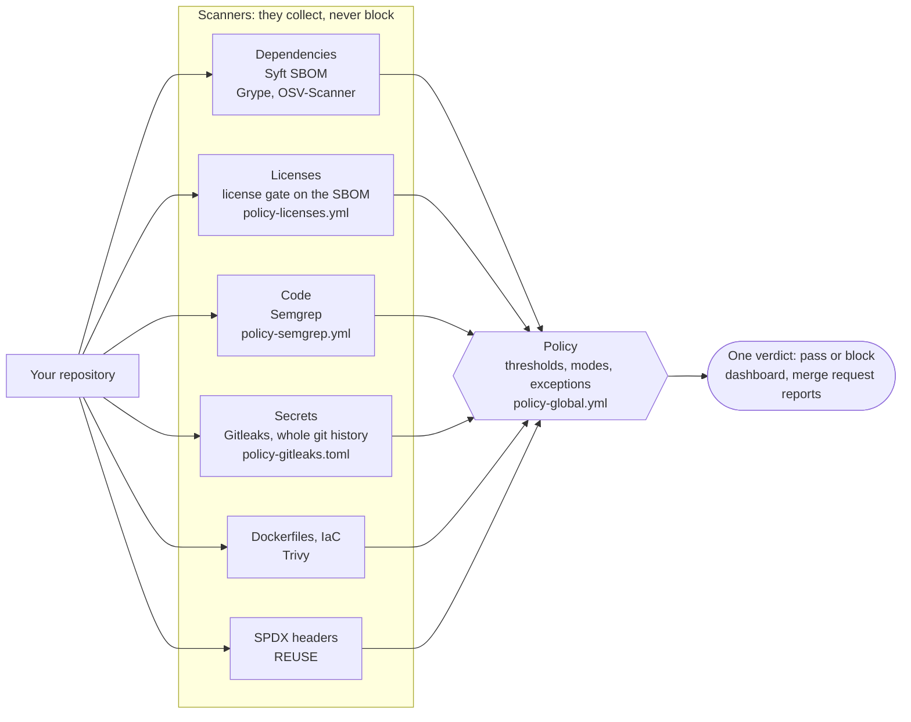
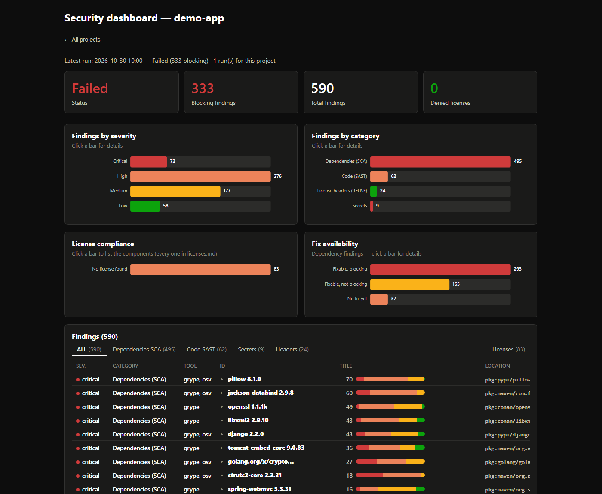

<!--
SPDX-FileCopyrightText: 2026 THALES

SPDX-License-Identifier: MIT
-->

# oss-analyzer

100% Open Source code analysis suite (security & compliance) for
[GitLab](https://gitlab.com/gitlab-org/gitlab) CI and GitHub Actions — SCA, SAST, secrets, and licenses, driven by
a single versioned policy. Polyglot repositories (Go, Rust, Java/JVM,
Python, JS/TS, C/C++). No SaaS, no code sent to a third party.

## Get started

oss-analyzer gates a repository on its security and compliance in CI: it
runs the scanners, applies one versioned policy and gives one verdict,
with an HTML dashboard and merge request reports.



The `policy-*` files are your settings, in your `security/` folder: each
one is optional and completes oss-analyzer's defaults (see
[Customizing oss-analyzer](#customizing-oss-analyzer)).

Every finding ends up in one dashboard, here on a deliberately vulnerable
demo project (590 findings, 333 of them blocking):



Three ways to run it, with the same policy and the same report:

### GitLab CI/CD component

```yaml
include:
  - component: gitlab.com/thalesgroup/oss-analyzer/analyze@0.4
```

That's all, on gitlab.com: the component is published in its CI/CD
Catalog from [gitlab.com/thalesgroup/oss-analyzer](https://gitlab.com/thalesgroup/oss-analyzer),
a read-only copy of this repository. On a self-managed instance, which
can only include its own projects, mirror that project there and include
it by its path on your instance; its image stays on
`registry.gitlab.com/thalesgroup/oss-analyzer` (`OSA_IMAGE_REPOSITORY`),
tagged with the component's commit SHA. The analysis runs in the `test` stage on merge requests, the
default branch, schedules and tags; `osa_report_aggregate` is the only job
that can block. The dashboard is linked as **OSS security dashboard** in
the MR pipeline widget, and the MR's Reports tab shows the findings
(Security scan, Code Quality).

- **Images** come from their public registries ([Docker Hub](https://hub.docker.com/), ghcr.io), at
  pinned versions. Behind a registry mirror, override the
  `OSA_<TOOL>_IMAGE` inputs — see
  [Container images](security/README.md#container-images).
- **Settings**: the organization defaults apply out of the box. To
  customize, add any of `security/policy-global.yml`,
  `policy-licenses.yml`, `policy-semgrep.yml`, `policy-gitleaks.toml`,
  holding only your differences — see
  [Customizing oss-analyzer](#customizing-oss-analyzer).
- **Common inputs**:
  ```yaml
      inputs:
        OSA_DISTRIBUTION_MODEL: distributed   # saas | distributed | oss_library
        OSA_MODE: audit                       # onboarding: report everything, never block
        OSA_JOB_NEEDS: ["build"]              # wait for your build first
  ```
  Every input is documented on the component's [CI/CD Catalog](https://docs.gitlab.com/ci/components/#cicd-catalog) page and in
  [templates/analyze.yml](templates/analyze.yml).
- **Project with a backlog**: `OSA_MODE: audit` reports everything and
  blocks nothing. `OSA_GATE_SCOPE: new` keeps blocking what's new: on a
  merge request, only what isn't already in the target branch's latest
  successful report blocks; elsewhere, findings are reported without
  blocking (so it needs merge request pipelines). See
  [New findings only](security/README.md#new-findings-only-osa_gate_scope-new).
- **MR summary comment**: `OSA_ENABLE_MR_COMMENT: true` posts the verdict,
  the blocking findings and the dashboard link as one comment, updated by
  every pipeline. It needs a project access token (scope `api`, role
  Reporter) in a masked `OSA_GITLAB_TOKEN` CI/CD variable.
- **[Maven](https://maven.apache.org/) project**: [Maven Central](https://central.sonatype.com/) throttles shared runners, and the
  resolved dependency graph is then lost. `OSA_MAVEN_MIRROR_URL` (e.g. a
  [Maven Central](https://central.sonatype.com/) remote of your artifact repository), with a masked `OSA_MAVEN_MIRROR_AUTH`
  variable if it needs credentials, resolves through a mirror instead —
  see [Known pitfalls](security/README.md#known-pitfalls).
- **Versions**: pin a minor version (`@0.4` follows its patches). The 0.x
  interface may still change until 1.0.0: a breaking change bumps the
  minor version, see [CHANGELOG.md](CHANGELOG.md).

### GitHub Actions reusable workflow

```yaml
jobs:
  security:
    uses: ThalesGroup/oss-analyzer/.github/workflows/security.yml@<ref>
    with:
      oss-analyzer-repository: ThalesGroup/oss-analyzer
      oss-analyzer-ref: <ref>   # the same ref as in `uses:`
```

Inputs, permissions and secrets: see
[GitHub Actions](security/README.md#github-actions).

### Local analysis, without CI

Analyze a received project archive (`.zip`, `.tar.gz`) or folder without
setting up CI:

```bash
security/scripts/analyze-archive.sh my-project.zip
```

The report and an HTML dashboard land under
`security-reports/<project-name>/` — see
[Usage](security/README.md#usage).

## Documentation

The full documentation is **[security/README.md](security/README.md)**:
setup, every input and setting, the reports, known pitfalls.
[CHANGELOG.md](CHANGELOG.md) lists the versions, breaking changes first.

### Why oss-analyzer

Good Open Source scanners exist for each concern: [Semgrep](https://github.com/semgrep/semgrep), [Gitleaks](https://github.com/gitleaks/gitleaks),
[Syft](https://github.com/anchore/syft), [Grype](https://github.com/anchore/grype), [OSV-Scanner](https://github.com/google/osv-scanner), [Trivy](https://github.com/aquasecurity/trivy), [cdxgen](https://github.com/CycloneDX/cdxgen), [REUSE](https://reuse.software/). What a team lacks is
rarely one more scanner. It's the part between them: one decision instead
of a pile of reports, rules that are written down instead of remembered,
and licenses treated as seriously as CVEs. oss-analyzer is that part.

#### One analysis, the whole software

Each run looks at the three surfaces of what you ship, together:

- **Your own code**: SAST ([Semgrep](https://github.com/semgrep/semgrep), registry packs plus in-house rules),
  secrets in the whole git history ([Gitleaks](https://github.com/gitleaks/gitleaks)), [SPDX](https://spdx.dev/) headers ([REUSE](https://reuse.software/)).
- **What you depend on**: one SBOM ([Syft](https://github.com/anchore/syft), plus [cdxgen](https://github.com/CycloneDX/cdxgen)'s resolved graph
  for [Maven](https://maven.apache.org/)/[Gradle](https://github.com/gradle/gradle)) feeds both the vulnerability scan ([Grype](https://github.com/anchore/grype), with
  [OSV-Scanner](https://github.com/google/osv-scanner) as a second opinion) and the license gate, so security and
  compliance judge the same component list.
- **What you deliver**: Dockerfiles and IaC, and the built container
  image ([Trivy](https://github.com/aquasecurity/trivy)).

#### What sets it apart

- **One verdict.** Scanners only collect; one job deduplicates their
  findings, applies the policy and decides.
- **No blind spot.** A scanner that left no report blocks like a finding:
  a green pipeline means everything was checked.
- **Policy as code.** Thresholds, exceptions, license lists, SAST and
  secret rules live in the repository, reviewed like code; projects only
  write their differences from the organization defaults.
- **Exceptions expire.** Each one has a reason, an approver and an expiry
  date, after which the finding blocks again.
- **Licenses taken seriously.** Allow / review / deny lists and
  [SPDX](https://spdx.dev/) expressions read as [SPDX](https://spdx.dev/)
  defines them (`OR`, `AND`, `WITH`).
- **Gradual adoption.** Audit mode, or blocking only what a merge request
  adds, lets a project with a backlog start today.
- **Same engine everywhere.** GitLab component, GitHub workflow or a
  local script on a folder or a received archive.
- **Nothing to host, reproducible.** No server, no SaaS, no code sent
  out; every tool image is pinned, so a version always analyzes the same
  way.

#### How it compares

Snapshot as of October 2026, from each project's documentation.

| Tool | What it is | Next to oss-analyzer |
|---|---|---|
| [MegaLinter](https://megalinter.io/) (security flavor) | Runs many linters and scanners ([Semgrep](https://github.com/semgrep/semgrep), [Grype](https://github.com/anchore/grype), [Syft](https://github.com/anchore/syft), [Trivy](https://github.com/aquasecurity/trivy), secret scanners...) in CI | Closest on running the tools; each one blocks on its own settings, with no shared policy, dated exceptions or license gate |
| [SecObserve](https://github.com/SecObserve/SecObserve) | Vulnerability and license management server, with CI templates and a security gate | Closest on triage and gating; needs a server and a database |
| [DefectDojo](https://github.com/DefectDojo/django-DefectDojo), [Dependency-Track](https://dependencytrack.org/) | Platforms that aggregate findings, or monitor SBOMs over time | Complementary: they track, oss-analyzer gates in CI. oss-analyzer uploads its SBOM to [Dependency-Track](https://github.com/DependencyTrack/dependency-track) |
| [OSS Review Toolkit](https://github.com/oss-review-toolkit/ort) | Deep license compliance as policy as code, with vulnerability advisors | Deeper on licenses, no SAST or secrets, heavier to run |
| [OWASP dep-scan](https://github.com/owasp-dep-scan/dep-scan) | Dependency vulnerabilities and licenses, with reachability analysis | SCA only; no SAST or secrets |
| [Trivy](https://github.com/aquasecurity/trivy) alone | Vulnerabilities, secrets, IaC, licenses in one binary | One of oss-analyzer's scanners; no SAST, no shared policy across tools |
| [GitLab Ultimate](https://about.gitlab.com/pricing/ultimate/) security scanning | GitLab's built-in SAST, dependency, secret and license scanning | Paid tier; oss-analyzer works on every GitLab edition and on GitHub, and still fills Ultimate's merge request widgets when available |

They aren't exclusive: oss-analyzer keeps each scanner's raw report as a
job artifact, in the formats those platforms import.

### Customizing oss-analyzer

Everything a project can tune lives in **one folder** (`security/`, the
`OSA_SETTINGS_DIR` input), under **one naming rule**:
`policy-<facet>.<the tool's own format>`. Each file is optional; one that's
present **completes** the organization default embedded in the
oss-analyzer image, it doesn't replace it. So each file only holds your
differences.

| File | Facet | Completes the default by |
|---|---|---|
| `policy-global.yml` | thresholds, modes, exceptions, settings | merging on top: your settings win, exceptions add up |
| `policy-licenses.yml` | license allow / review / deny lists | reclassifying the licenses it names |
| `policy-semgrep.yml` | in-house SAST rules ([Semgrep](https://github.com/semgrep/semgrep)) | running in addition to oss-analyzer's |
| `policy-gitleaks.toml` | secrets rules and allowlist ([Gitleaks](https://github.com/gitleaks/gitleaks)) | extending oss-analyzer's, itself extending [Gitleaks](https://github.com/gitleaks/gitleaks)' defaults |

To replace a default instead of completing it: `meta.inherit: false`
(the whole policy), `sast.inherit_rules: false` ([Semgrep](https://github.com/semgrep/semgrep) rules),
`secrets.inherit_rules: false` ([Gitleaks](https://github.com/gitleaks/gitleaks)). To drop one of oss-analyzer's
[Semgrep](https://github.com/semgrep/semgrep) rules: `sast.disabled_rules`; to change the registry packs:
`sast.registry_packs`. The CI inputs only say how the pipeline runs
(stages, `needs`, images, steps enabled); what gets detected and what
blocks is in these files. The `osa_prepare` job log prints, for each
facet, whether the default or your file applied.

Minimal examples, each file on its own:

```yaml
# security/policy-global.yml — stricter on vulnerabilities, one Semgrep rule off
vulnerabilities:
  fail_on: medium
sast:
  disabled_rules: [go-ignored-error]
```

```yaml
# security/policy-licenses.yml — this project ships binaries: block GPL
deny: [GPL-2.0-only, GPL-2.0-or-later, GPL-3.0-only, GPL-3.0-or-later]
```

```yaml
# security/policy-semgrep.yml — one more rule, alongside oss-analyzer's
rules:
  - id: no-eval
    languages: [python]
    severity: ERROR
    message: eval() on untrusted input
    pattern: eval(...)
```

```toml
# security/policy-gitleaks.toml — no [extend]: oss-analyzer adds it
[[rules]]
id = "project-token"
description = "Project API token"
regex = '''\bPRJ-[0-9]{12}\b'''
```

Limits worth knowing: a [Semgrep](https://github.com/semgrep/semgrep) rule you define with the same ID as one of
oss-analyzer's runs alongside it (disable ours to replace it; `osa_prepare`
warns); [Gitleaks](https://github.com/gitleaks/gitleaks) follows two `[extend]` levels at most, which is why your
file must not have its own. A file that's a byte-for-byte copy of the
default is ignored (logged as such), so a copied default never runs
twice. The GitHub reusable workflow resolves the settings the same way
(its `prepare` job), from oss-analyzer's own checkout.

Stability: the settings format is versioned (`meta.version`, currently
`1`). A policy declaring another version, or a value the scripts would
misread (an unknown severity, a non-boolean flag), stops `osa_prepare`
with an error; a key no script reads (a typo) is reported as a warning in
its log. A later change of this format would bump `meta.version` and come
with its migration in the [CHANGELOG](CHANGELOG.md).

### Structure

```
templates/analyze.yml                   # the `analyze` CI/CD component
CHANGELOG.md                            # component versions, breaking changes first
Dockerfile                              # oss-analyzer image: the scripts the component runs
.gitlab-ci.yml                          # this project's pipeline: image, self-test, tests, release
.github/workflows/security.yml          # same chain as a GitHub reusable workflow
security/
├── README.md                           # operations and usage doc
├── policy-global.yml                   # settings: thresholds, modes, exceptions (organization defaults)
├── policy-licenses.yml                 # license allow / review / deny lists
├── policy-semgrep.yml                  # in-house SAST rules (Semgrep)
├── policy-gitleaks.toml                # secrets rules + allowlist (Gitleaks)
└── scripts/
    ├── analyze-archive.sh              # one-off analysis of an archive/folder, outside CI
    ├── generate_dashboard.py           # visual HTML dashboard, multi-run, clickable
    ├── license_gate.py                 # evaluates the SBOM against the license policy
    ├── aggregate_report.py             # aggregates all scanners + applies the policy
    ├── fetch_baseline.py               # target branch's report, for the new-findings-only gate
    ├── mr_comment.py                   # summary comment on the merge request
    ├── prepare_settings.py             # resolves every settings file: defaults completed by the project's
    ├── policy.py                       # effective policy: base + project merge, modes, distribution model
    ├── license_ids.py                  # license label normalization, SPDX exception IDs
    ├── license_lists.py                # layout of policy-licenses.yml (entry groups)
    ├── build_license_catalog.py        # draft verdict for every SPDX ID, for legal review
    ├── license_sources.py              # SPDX / ScanCode upstream databases (download)
    ├── gitlab_reports.py               # GitLab native MR reports (Security scan, Code Quality)
    └── advisories.py                   # advisory links shared by the dashboard and GitLab reports
```

## Contributing

Issues and pull requests are welcome. Pull requests are reviewed here,
then integrated upstream and published with the next release, which
credits their authors: start by reading the
[contributing guide](CONTRIBUTING.md). Security issues: see
[SECURITY.md](SECURITY.md).

## Acknowledgments

oss-analyzer is a thin layer on top of the work of others. Without these
Open Source projects, and the communities who build, maintain and feed
them every day, none of it would be possible. Thank you.

**Scanners**

- [Syft](https://github.com/anchore/syft) and
  [Grype](https://github.com/anchore/grype), by [Anchore](https://anchore.com/): the SBOM and the
  dependency vulnerability scan.
- [cdxgen](https://github.com/CycloneDX/cdxgen) and
  [CycloneDX CLI](https://github.com/CycloneDX/cyclonedx-cli): the
  resolved dependency graph of [Maven](https://maven.apache.org/) and
  [Gradle](https://github.com/gradle/gradle) projects, merged into the
  SBOM.
- [OSV-Scanner](https://github.com/google/osv-scanner), and the
  [OSV](https://osv.dev/) database it queries: the second opinion on
  dependency vulnerabilities.
- [Semgrep](https://github.com/semgrep/semgrep) and the contributors of
  its rule registry: the static analysis of your own code.
- [Gitleaks](https://github.com/gitleaks/gitleaks): secrets in the whole
  git history.
- [Trivy](https://github.com/aquasecurity/trivy), by [Aqua Security](https://www.aquasec.com/):
  Dockerfiles, IaC and container images.
- [REUSE](https://reuse.software/), by the Free Software Foundation
  Europe: the [SPDX](https://spdx.dev/) headers of every file.
- [Dependency-Track](https://github.com/DependencyTrack/dependency-track),
  by [OWASP](https://owasp.org/): continuous monitoring of the SBOM, when enabled.

**Standards and data**

- [CycloneDX](https://cyclonedx.org/) and [SPDX](https://spdx.dev/): the
  SBOM formats, and the license list and expressions the license gate
  reads.
- [ScanCode LicenseDB](https://github.com/aboutcode-org/scancode-licensedb),
  by AboutCode: the license names mapped to [SPDX](https://spdx.dev/) identifiers.
- The vulnerability databases behind the scanners, among them the
  [GitHub Advisory Database](https://github.com/github/advisory-database)
  and the [National Vulnerability Database](https://nvd.nist.gov/), and
  everyone who reports and documents vulnerabilities in them.

**Runtime**

- [Python](https://www.python.org/), with
  [PyYAML](https://github.com/yaml/pyyaml) and
  [jsonschema](https://github.com/python-jsonschema/jsonschema): the
  report scripts.
- GitLab CI/CD components and
  [Docker](https://github.com/moby/moby) images: how it all runs.

## License

oss-analyzer is released under the [MIT License](LICENSE). Each file
carries its [SPDX](https://spdx.dev/) license identifier ([REUSE](https://reuse.software/));
the license texts are in [LICENSES/](LICENSES/).
